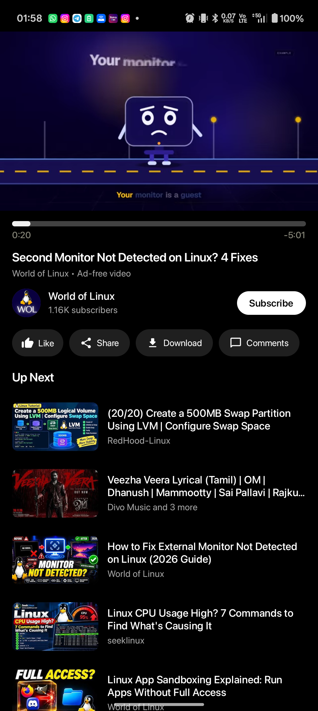
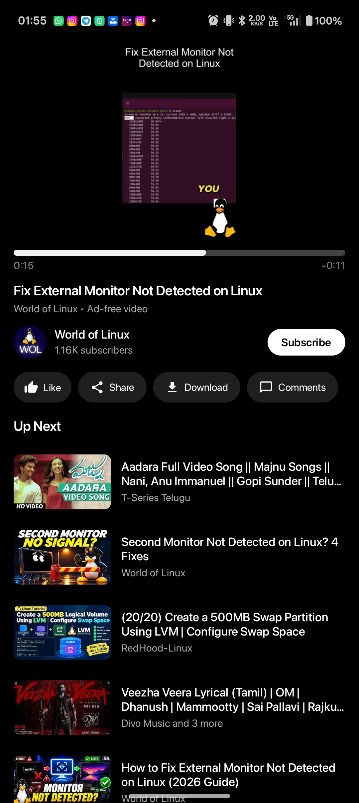
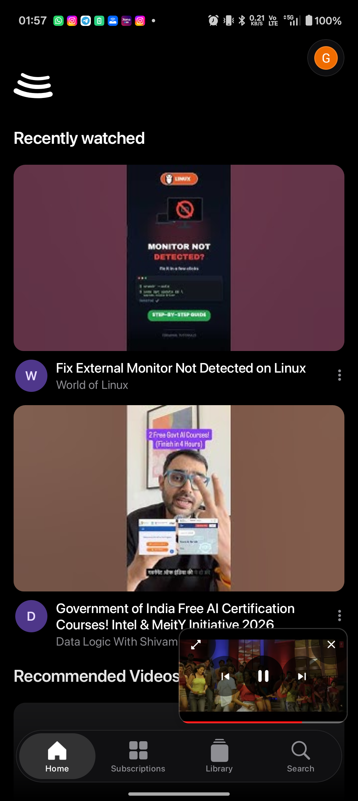
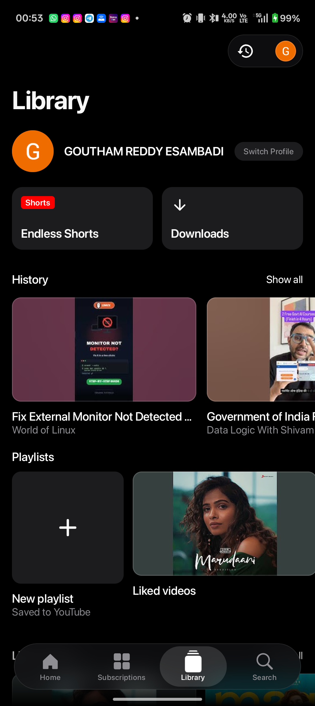

# BitTube

BitTube is a lightweight, high-performance, ad-free YouTube and Shorts client for Android built using Kotlin Multiplatform and Jetpack Compose.

---

## Screenshots

| Video Player | Shorts in 16:9 Frame | Mini Player PiP | Library & Playlists |
|:---:|:---:|:---:|:---:|
|  |  |  |  |

---

## Features

### Video & Shorts Playback
* Video-first experience: Tapping any video immediately opens the full playback interface with recommendations, description, and comments.
* Pillarboxed Shorts: Vertical videos and Shorts remain framed within a 16:9 container, keeping metadata, channel subscription, comments, and recommendations accessible below.
* Floating PiP Miniplayer: Minimizing the player smoothly slides it into a compact 16:9 picture-in-picture window with inline touch controls and progress indicator.
* Smooth gesture navigation: Minimize the active player using the top-left chevron, back swipe, or Android system back button.
* Background and lock screen playback supported through Android Media3 session management.

### Account & Library
* Google Account Authentication: Integrated OAuth web session using modern mobile user agents to access personal feeds securely.
* Full Library synchronization: Access Liked Videos, custom playlists, subscription feeds, and watch history.
* Clean Library interface: Streamlined playlist overview focused purely on user and channel content.

### Interface & Performance
* Frosted glass aesthetic: Translucent overlays and dynamic color extraction powered by Haze and Material Design 3.
* Optimized hardware rendering: Hardware-accelerated video decoding using ExoPlayer and custom TextureView surfaces.
* Ad-free streaming: Direct stream resolution via InnerTube without commercial video interruptions.

---

## Architecture & Tech Stack

* Framework: Kotlin Multiplatform (KMP) & Jetpack Compose
* Media Engine: AndroidX Media3 (ExoPlayer) with custom TextureView video renderer
* Data Layer: YouTube InnerTube API parser and NewPipe Extractor integration
* UI Styling: Material 3, Haze dynamic blur engine
* Minimum SDK: Android 8.0 (API Level 26)
* Target SDK: Android 15 (API Level 35)

---

## Building from Source

### Prerequisites
* JDK 17 or higher
* Android SDK (API 35, Build Tools 35.0.0)
* Android NDK (27.0.12077973)
* CMake 3.22.1+

### Build Steps
1. Clone the repository:
   ```bash
   git clone https://github.com/goutham-11-16/bitTube.git
   cd bitTube
   ```

2. Assemble the debug APK:
   ```bash
   ./gradlew :app:assembleProdDebug
   ```

3. The generated APK will be available at:
   ```text
   app/build/outputs/apk/prod/debug/app-prod-arm64-v8a-debug.apk
   ```

---

## Attribution & Credits

BitTube is developed on top of the open-source architecture of [BitChord](https://github.com/kushagrasinghx/BitChord) by Kushagra Singh (@kushagrasinghx).

Special thanks to:
* [NewPipe Extractor](https://github.com/TeamNewPipe/NewPipeExtractor) for stream parsing utilities.
* [Haze](https://github.com/chrisbanes/haze) for frosted-glass blurs in Compose.

---

## License

This project is licensed under the terms of the GNU General Public License v3.0 (GPLv3). See the [LICENSE](LICENSE) file for complete details.
